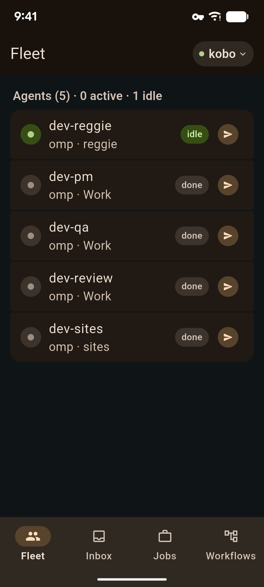

[![CI][ci-badge]][ci-url]

[ci-badge]: https://github.com/geoffjay/tower-mobile/actions/workflows/ci.yml/badge.svg
[ci-url]: https://github.com/geoffjay/tower-mobile/actions/workflows/ci.yml

---

# Tower Mobile

Android client for [Tower](https://github.com/geoffjay/tower). Monitor and control coding agents on remote hosts over SSH.

<p align="center">
  
</p>

## Features

- **SSH tunnel transport**: Connects over SSH and forwards traffic to `127.0.0.1:8266` on the host. You do not expose the Tower API on the network, and the host does not need `herdr`.
- **Key bootstrap**: Uses your SSH password once to install a device Ed25519 key in `authorized_keys`. Later launches sign in with that key and auto-connect at startup.
- **Multi-host switcher**: Stores multiple hosts and switches the active tunnel from the top app bar. Bearer tokens and the private key stay in Android Keystore via `flutter_secure_storage`.
- **Fleet**: Displays agent seats, live states, terminal tails, and assigned jobs. Send prompts from the Fleet list or from the agent detail screen.
- **Inbox**: Displays pending questions and approval requests with deadline badges and a tab counter. Answer questions, approve or deny requests, or dismiss messages.
- **Jobs**: Displays the open priority queue and recent closed jobs. Queue jobs, assign or release owners, cancel jobs, and inspect event trails.
- **Workflows**: Displays workflow definitions and recent runs. Start runs with validated inputs and follow step progress live.
- **Live updates**: Streams `/v1/events` with `?cursor=<seq>` resume, pauses in the background to save battery, and reconnects after network drops.
- **Material 3 Expressive**: Supports system light and dark themes, Android dynamic wallpaper colors, and Expressive surfaces.

## Documentation

Project design and operational notes live in the [knowledge base](docs/knowledgebase/index.md):

- [Tower API surface for a mobile client](docs/knowledgebase/concepts/tower-api-surface.md)
- [SSH tunnel transport decision](docs/knowledgebase/decisions/ssh-tunnel-transport.md)
- [v1 implementation plan](docs/knowledgebase/plans/mobile-v1.md)
- [v1 follow-ups](docs/knowledgebase/plans/mobile-v1-follow-ups.md)

## Prerequisites

- Flutter 3.47.0 or newer (Dart 3.13.4+).
- Android device or emulator.
- A host running `sshd` and `tower serve`.

## Development

```sh
flutter pub get            # install dependencies
flutter analyze            # run static analysis
flutter test               # run unit and widget tests
flutter run                # run on a connected Android device
flutter build apk --debug  # build a debug APK
```

## Releasing

Push a `v*` tag to run CI, build release APKs (`arm64-v8a`, `armeabi-v7a`, `x86_64`, and `universal`) with `checksums.txt`, and publish a GitHub Release:

```sh
git tag v0.1.0 && git push origin v0.1.0
```

Set these optional repository secrets to sign release APKs with a production keystore (otherwise builds fall back to debug signing):

- `ANDROID_KEYSTORE_BASE64`
- `ANDROID_KEYSTORE_PASSWORD`
- `ANDROID_KEY_ALIAS`
- `ANDROID_KEY_PASSWORD`
