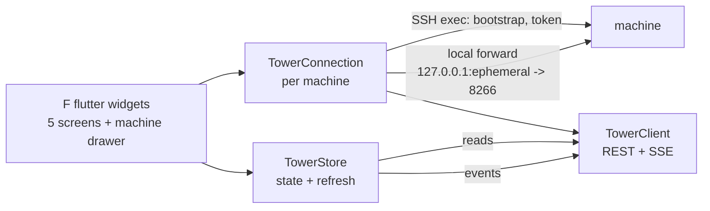
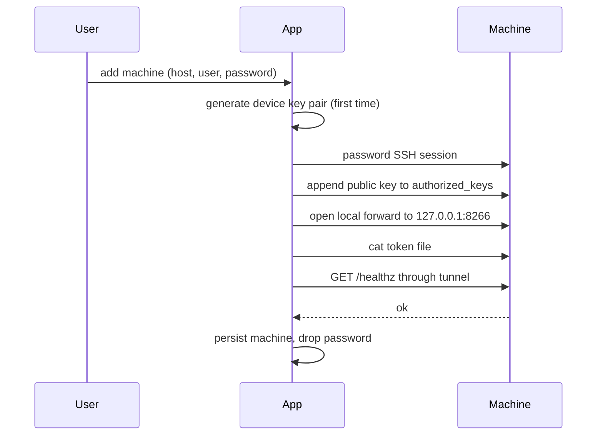

# tower-mobile v1: Flutter Android client

Date: 2026-11-11. Status: proposed.

A Flutter app for Android that monitors and controls tower servers. Each
machine is an SSH target with its own tower server; see
[SSH tunnel transport, no herdr dependency](../decisions/ssh-tunnel-transport.md)
for the connection design and
[Tower API surface for a mobile client](../concepts/tower-api-surface.md)
for the API contract.

## Scope

v1 requirements, each mapped to the API route that serves it:

| Requirement | Routes |
| --- | --- |
| Monitor agents | `GET /v1/agents`, `GET /v1/agents/{id}/read`, SSE |
| Monitor jobs | `GET /v1/tasks`, `GET /v1/tasks/{id}` |
| Monitor workflows | `GET /v1/workflows`, `GET /v1/runs`, `GET /v1/runs/{id}` |
| Monitor the inbox | `GET /v1/messages?to=me&status=pending`, SSE |
| Send a prompt to an agent | `POST /v1/agents/{id}/prompt` |
| Respond to inbox messages | `POST /v1/messages/{id}/respond`, `…/dismiss` |
| Queue a job | `POST /v1/tasks` |
| Assign a queued job | `POST /v1/tasks/{id}/assign` |
| Initiate a workflow run | `POST /v1/workflows/{name}/runs` |
| Multiple machines, switch between them | one SSH connection per machine, active one open |

Out of scope for v1: iOS (build config only later), schedules management,
workflow authoring (apply/edit), job editing, spawn/stop/interrupt, event
log browsing, agent screen rendering, artifacts, MCP. The herdr app panels
(see the tower repo `app/` layout) are the reference for a later v2.

## Architecture

Three layers, one package per layer:

- **Connection** (`lib/src/connection/`): `MachineRegistry` (stored
  machines), `TowerConnection` (SSH session, port forward, token fetch,
  health), `KeyBootstrap` (device key pair, `authorized_keys` append).
- **API** (`lib/src/api/`): `TowerClient` (typed wrappers over the routes
  in the concept doc, error mapping to `TowerApiError`), `EventFeed`
  (SSE with cursor resume), domain models generated to mirror the
  `tower-core` shapes.
- **UI** (`lib/src/features/`): one feature package per screen, a
  `ConnectionScope` inherited widget, and a `MachineSwitcher` drawer.

State management: `flutter Riverpod`. Serialization:
`dartssh2` for SSH, `ssh2`-compatible OpenSSH key format for the device
key pair, `flutter_secure_storage` for the token and machine list,
`shared_preferences` for UI preferences.

## Screens (v1)

1. **Machines** — list of added machines, connect status, add-machine
   wizard (host, port, username, password; bootstrap key on first
   connect), switch active machine. Pull-to-refresh re-runs health.
2. **Fleet** (`GET /v1/agents`) — agent rows with state dot
   (`working/blocked/done/idle/dead` colors from the herdr palette),
   name, kind, owned job. Tap opens **Agent detail**: facts, prompt
   input (sends `POST /v1/agents/{id}/prompt`).
3. **Inbox** (`GET /v1/messages?to=me&status=pending`) — pending items
   with kind dot, sender, deadline countdown (red when passed). Answer
   inline, approve/deny with two-press confirm, dismiss.
4. **Jobs** (`GET /v1/tasks`) — open jobs (queued/assigned/working/
   input-required) and a collapsible "recent closed" section. Tap opens
   **Job detail**: trail, facts, result. Actions: assign (agent picker
   from `GET /v1/agents`), release, cancel (two-press).
   FAB: queue-job form (title, description, priority, tags, optional
   assign target, `not_before`).
5. **Workflows** (`GET /v1/workflows`) — rows with open-runs badge,
   enabled state. Tap opens **Workflow detail**: recent runs, inputs
   form, Run button (required inputs enforced client-side, same rule as
   the herdr `missingInputs` check). Run view follows
   `GET /v1/runs/{id}` with step states; cancel (two-press).

Inbox badge on the navigation bar while any item is pending — same rule
as the herdr tab badge (10 s poll when the inbox screen is closed).

## Live updates

Screens refresh from the SSE feed where it helps: fleet, inbox, jobs,
workflow runs. Event kinds used: `agent.state`, `task.created`,
`task.status`, `task.assigned`, `message.created`, `message.status`,
`workflow.run.*`, `workflow.step.*`. The feed runs per active machine
with `?cursor=<seq>` resume after a tunnel drop. Poll fallback: 10 s for
lists (the herdr cadence), 3 s for an open run detail, 2 s for an open
agent screen. `agent.output` events are excluded on the main feed.

## Connect flow

Later connects skip the password session: key auth, then forward, token,
health. The app stores machines (host, port, username, key reference) and
the last event cursor per machine. Only the active machine's connection
stays open in v1; switching machines closes the old connection and resets
the SSE cursor (seqs are per server).

## Milestones

| # | Milestone | Done when |
| --- | --- | --- |
| M1 | Project scaffold + models | `flutter run` on an Android device shows the Machines screen; API models parse live `--json` samples |
| M2 | Connection layer | Add-machine wizard connects to a real tower host, bootstraps the key, forwards the port, passes `/healthz`; token kept in secure storage |
| M3 | Read-only screens | Fleet, Inbox, Jobs, Workflows lists render live data from the tunnel; SSE feed refreshes them |
| M4 | Actions | Prompt, answer/approve/dismiss, queue job, assign, release, cancel, run workflow — each returns the server's response; errors map to UI strips |
| M5 | Detail polish | Agent detail, job detail with trail, workflow run following; two-press confirm; inbox badge |
| M6 | Hardening | Reconnect + cursor resume after tunnel drop and app backgrounding; battery review (feed paused when app is in background) |

Verification per milestone is manual against a live `tower serve` with
real agents, plus a throwaway harness for the connection layer (connect,
bootstrap, forward, health) run on an Android emulator.

## Risks

- **SSH host verification.** v1 records the host key fingerprint on first
  connect (trust-on-first-use) and refuses a changed fingerprint. It does
  not pin the key out-of-band; a MITM at first connect goes undetected.
- **dartssh2 stability on Android.** The package is active (4.1.0) with
  Android in its platform list, but the app must hold the SSH session for
  the app's lifetime. M2 proves this early. Fallback: `flutter_ssh2`-style
  native bindings, at the cost of a native dependency.
- **SSE over a forwarded port.** herdr proved the pattern with bounded
  `curl` polls; the app uses a held SSE connection with keep-alive
  (server sends a comment every 15 s). If a held connection proves
  unstable on mobile networks, fall back to bounded polls of
  `/v1/events` with cursor resume — the herdr pattern.
- **Token in app storage.** The bearer token is full operator control.
  `flutter_secure_storage` (Android Keystore) is the floor; no logging of
  the token, ever.
- **Battery.** One SSE connection for the active machine only; feed
  paused in background; lists poll at 10 s otherwise. herdr's fleet uses
  the same cadence on desktop.

## Non-goals

- No iOS build in v1 (Flutter keeps the door open).
- No `tower node` integration (phase-5 stub in tower).
- No herdr dependency or control of herdr from the app.
- No tunneling tool beyond SSH (no Tailscale setup automation).
- No workflow authoring or schedule management.
